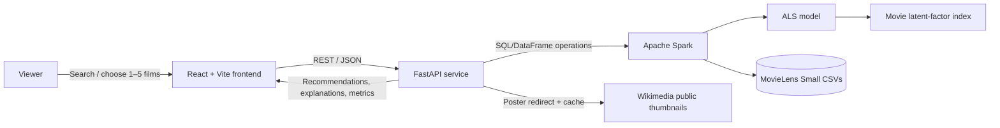
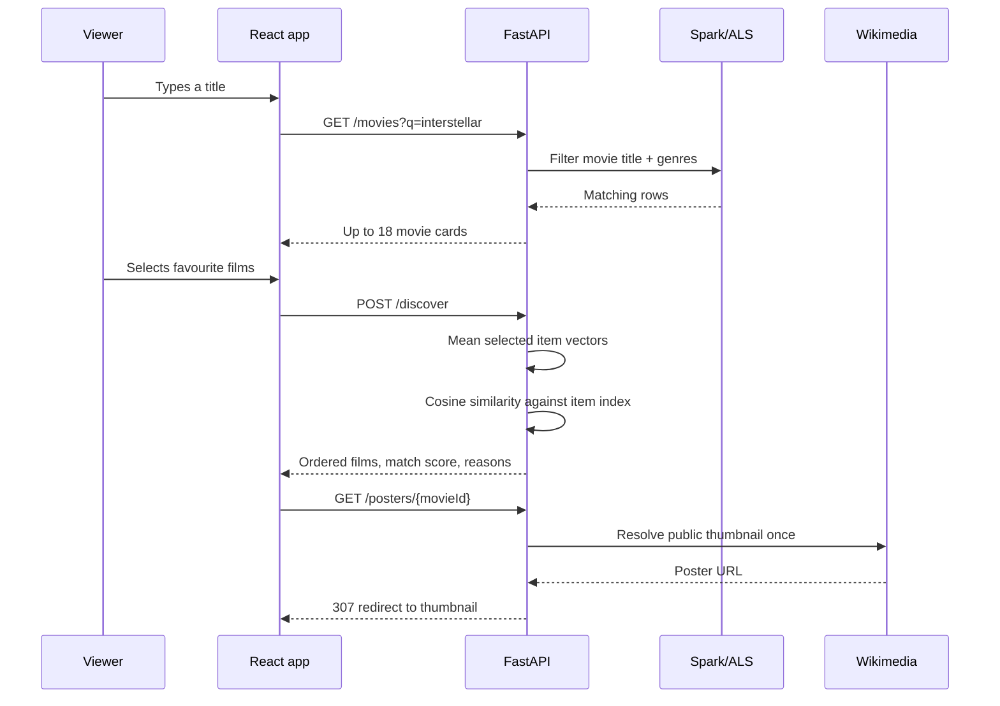
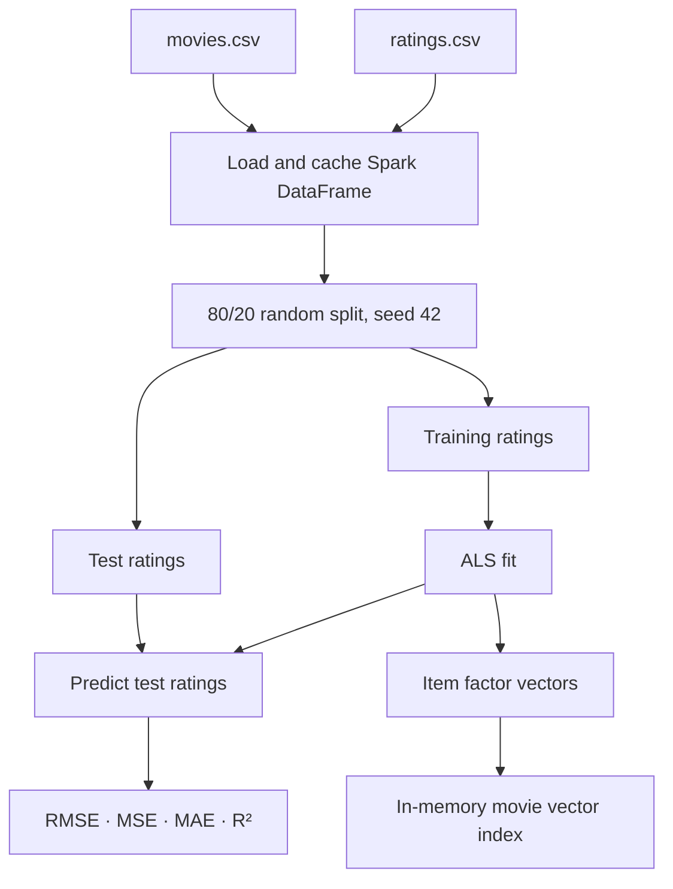
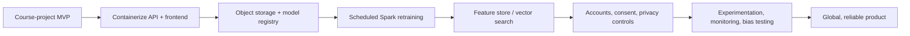

# CineMatch

> A Spark-powered movie discovery experience that turns a handful of films into a personal recommendation profile.

CineMatch is a full-stack Big Data Analytics project built from the exploratory work in `bda_prj.ipynb`. Visitors search the MovieLens catalogue, select up to five films they love, and receive explainable recommendations from an Apache Spark ALS collaborative-filtering model. The product is designed as a polished discovery experience rather than a notebook demo: it has live server-side search, poster thumbnails, match scores, explanations, responsive UI, and model-health visibility.


## Contents

- [What it does](#what-it-does)
- [Architecture](#architecture)
- [Recommendation methodology](#recommendation-methodology)
- [Data](#data)
- [Frontend experience](#frontend-experience)
- [Backend API](#backend-api)
- [Getting started](#getting-started)
- [Project structure](#project-structure)
- [Evaluation](#evaluation)
- [Operations and troubleshooting](#operations-and-troubleshooting)
- [Roadmap to production](#roadmap-to-production)
- [Credits and licensing](#credits-and-licensing)

## What it does

1. Search titles or genres from the MovieLens catalogue without downloading it into the browser.
2. Choose one to five favourite movies to create a lightweight taste profile.
3. Combine the ALS latent vectors of those choices and retrieve nearest films by cosine similarity.
4. Explain each result with a match percentage, shared genres, and three concise reasons.
5. Show real poster images when a public Wikimedia poster is available; use a designed fallback when it is not.
6. Expose standard recommender quality metrics—RMSE, MSE, MAE, and R²—computed from a reproducible holdout split.

## Architecture



### Component responsibilities

| Layer | Technology | Responsibility |
| --- | --- | --- |
| Experience | React 19, CSS, Vite | Search, selection state, loading/retry handling, result presentation, mobile layout |
| API | FastAPI, Pydantic | Request validation, CORS, readiness and API contracts |
| Analytics | PySpark MLlib | Data loading, reproducible split, ALS training, prediction evaluation |
| Serving index | NumPy | In-memory cosine-similarity lookup over ALS item vectors after model training |
| Data | MovieLens Small | Movies, ratings, tags, and external-link metadata |
| Poster service | Wikimedia REST summary API | On-demand poster discovery, redirect, and in-memory URL cache |

### Request flow



## Recommendation methodology

### Training pipeline



### Why ALS?

ALS (Alternating Least Squares) factorizes the sparse user–movie rating matrix into compact user and movie representations. In practical terms, it learns hidden dimensions of taste from many users’ ratings—rather than relying only on labels such as “Action” or “Drama.” It is a classic Spark-native choice for scalable collaborative filtering.

The model configuration preserves the tuned direction established in the notebook:

| Parameter | Value | Purpose |
| --- | ---: | --- |
| `rank` | 10 | Number of learned latent taste factors |
| `maxIter` | 20 | ALS optimisation passes |
| `regParam` | 0.15 | Regularisation against overfitting |
| `coldStartStrategy` | `drop` | Omits predictions for unseen user/movie combinations in evaluation |
| split seed | 42 | Makes the train/test evaluation repeatable |

### Multi-film discovery algorithm

The product-facing discovery endpoint does not require a visitor to be an existing MovieLens user. It uses selected movies as a temporary profile:

```text
selected vector = mean(ALS vector for each selected movie)
similarity(movie) = cosine(selected vector, ALS vector for movie)
recommendations = highest-scoring non-selected movies
```

This is a transparent bridge between an offline collaborative-filtering model and a first-time visitor. The API also retains `POST /recommendations` for classic ALS top-N recommendations for an existing MovieLens `user_id`.

### Explainability

Each discovery result includes:

- **Match percentage:** normalized cosine proximity in the learned ALS item space.
- **Why this pick:** a plain-language audience-pattern explanation.
- **Genre relationship:** explicitly calls out genres shared with selected films when present.
- **Three takeaways:** primary genre, genre connection, and collaborative-signal rationale.

The match percentage is a ranking/affinity signal, not a claim that a user will enjoy the film with that probability.

## Data

The bundled `ml-latest-small` directory is the [MovieLens Latest Small dataset](https://grouplens.org/datasets/movielens/latest/).

| File | Used for |
| --- | --- |
| `ratings.csv` | ALS training and evaluation; 100,836 ratings |
| `movies.csv` | Titles and genre labels; 9,742 movies |
| `links.csv` | External MovieLens identifiers |
| `tags.csv` | Included source data for future content/tag work |

At runtime, the API reports its actual catalogue counts via `GET /health`—typically **9,742 films**, **100,836 ratings**, and **610 users** for the bundled version.

## Frontend experience

The frontend is intentionally designed as a film-discovery editorial rather than an admin dashboard:

- Dark cinematic taste-building workspace with high-contrast accents.
- Debounced, server-side search; stale requests are cancelled while a visitor keeps typing.
- Up to five removable selection chips.
- A quiet readiness poll during Spark startup, rather than a permanent failure message.
- Curated high-rated starting titles for visitors who do not know what to select.
- Aligned, poster-led result cards with reasons and genre context.
- Designed thumbnail fallback for films with no available public poster.
- Responsive layout for smaller displays.

## Backend API

The API starts on `http://localhost:8000`.

| Method | Endpoint | Description |
| --- | --- | --- |
| `GET` | `/` | Service name and high-level status |
| `GET` | `/health` | Model readiness plus catalogue statistics |
| `GET` | `/metrics` | Evaluation metrics and ALS parameters |
| `GET` | `/movies?q=&limit=` | Title/genre search, capped at 48 rows |
| `GET` | `/featured?limit=` | Well-reviewed films with enough ratings |
| `GET` | `/posters/{movie_id}` | Cached redirect to a public film thumbnail |
| `POST` | `/discover` | Multi-film taste-profile discovery |
| `POST` | `/recommendations` | Top-N ALS predictions for an existing MovieLens user |

### Discovery example

```bash
curl -X POST http://localhost:8000/discover \
  -H 'Content-Type: application/json' \
  -d '{"movie_ids": [1, 50, 1196], "num_recommendations": 12}'
```

Example response shape:

```json
{
  "recommendations": [
    {
      "movieId": 260,
      "title": "Star Wars: Episode IV - A New Hope (1977)",
      "genres": "Action|Adventure|Sci-Fi",
      "posterUrl": "http://localhost:8000/posters/260",
      "match": 99.6,
      "whySelected": "Its audience-rating pattern is a 99.6% match for your taste profile.",
      "highlights": [
        "Action is at the heart of this pick.",
        "Shares Action, Adventure with your selections.",
        "Chosen from a cluster of viewers whose ratings resemble yours."
      ]
    }
  ],
  "based_on": [1196],
  "method": "ALS latent-factor similarity"
}
```

## Getting started

### Prerequisites

- Python 3.13+
- Node.js 18+
- Java 8+; Java 17 is a strong modern choice for Spark

### Install

```bash
# Backend
cd backend
python3 -m venv venv
source venv/bin/activate
pip install -r requirements.txt

# Frontend, in another terminal
cd frontend
npm install
```

### Run

```bash
# terminal 1
cd backend
source venv/bin/activate
python main.py

# terminal 2
cd frontend
npm run dev
```

Open the Vite URL, normally `http://localhost:5173`.

The first backend start trains the Spark model and can take longer than ordinary API startup. The UI retries readiness automatically. Later requests are fast because the model and item-vector index remain in memory.

Convenience scripts are also included:

```bash
./start.sh
./stop.sh
```

## Project structure

```text
cinematch/
├── backend/
│   ├── main.py                 # FastAPI routes, Spark training, serving/index logic
│   └── requirements.txt        # Python dependencies
├── frontend/
│   ├── src/
│   │   ├── App.jsx             # React state and discovery interaction
│   │   ├── App.css             # Visual system and responsive layout
│   │   └── index.css           # Global CSS reset
│   ├── package.json
│   └── vite.config.js
├── ml-latest-small/            # Bundled MovieLens source dataset
├── bda_prj.ipynb               # Original analysis, tuning and experimentation
├── start.sh                    # Local service launcher
├── stop.sh                     # Local service shutdown helper
└── README.md
```

## Evaluation

Metrics are evaluated every time the API trains on the deterministic 80/20 test split. The tuned notebook run and current service yield an RMSE of approximately **0.8679** on MovieLens Small.

| Metric | Meaning |
| --- | --- |
| RMSE | Penalizes larger rating-prediction errors more strongly; lower is better |
| MSE | Mean squared rating-prediction error; lower is better |
| MAE | Average absolute rating-prediction error; lower is better |
| R² | Fraction of test-set rating variation explained by predictions; higher is better |

Use the running service’s `/metrics` response rather than treating a README value as a fixed benchmark: dataset changes, Spark versions, and model settings can alter observed results.

## Operations and troubleshooting

| Symptom | Likely cause | Resolution |
| --- | --- | --- |
| UI stays on its preparation state | Spark is training or Java is unavailable | Check `backend.log`, verify `java -version`, then refresh after the API is ready |
| Search returns no results | Title spelling or no MovieLens match | Try fewer terms, a genre, or a different title |
| Poster shows graphic fallback | No Wikimedia thumbnail found for that title | This is intentional; recommendation data still works |
| Browser cannot call API | Backend is not on port 8000 | Start `python main.py` and check CORS/ports |
| PySpark gateway error | Java/Spark network setup | Confirm a compatible Java installation and avoid a stale Spark process |
| Port already in use | An older app instance is running | Stop the old process or use the included stop script |

### Development checks

```bash
# Backend syntax check
backend/venv/bin/python -m py_compile backend/main.py

# Frontend production build and lint
cd frontend
npm run build
npm run lint
```

## Privacy, reliability, and limitations

- This is an educational local project. It does not create accounts or collect new user data.
- MovieLens user IDs are dataset IDs, not CineMatch accounts.
- Public poster availability is best-effort; the UI deliberately has a non-network fallback.
- ALS reflects historical MovieLens preferences and may reproduce biases or popularity effects in that dataset.
- Latent-factor similarity measures proximity in a learned rating space; it does not understand plot, safety, availability, or age suitability.
- The compact in-memory vector index suits MovieLens Small. A large production catalogue should use distributed/vector retrieval and precomputed recommendations.

## Roadmap to production



To responsibly operate at public scale, CineMatch would need licensed/current catalogue and artwork data, authentication and consent, observability, caching, automated retraining, A/B experimentation, security review, accessibility testing, content controls, availability data, and privacy/legal processes. The included ALS workflow is the analytical core—not the entirety of a global consumer product.

## Credits and licensing

- MovieLens data: [GroupLens Research](https://grouplens.org/datasets/movielens/). Review its usage terms before redistribution or commercial use.
- Poster thumbnails: public Wikimedia sources when available; use remains subject to the relevant source licences and fair-use/local policy considerations.
- Apache Spark, FastAPI, React, Vite, NumPy, and their respective trademarks belong to their owners.

---

Built as a Big Data Analytics project with Apache Spark and a product-minded frontend.
